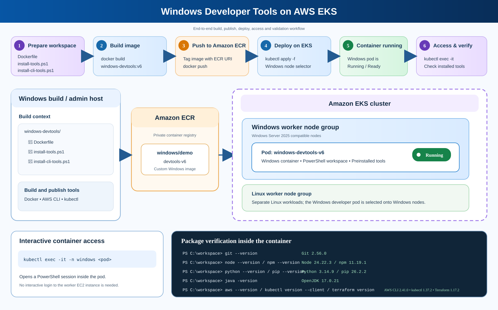
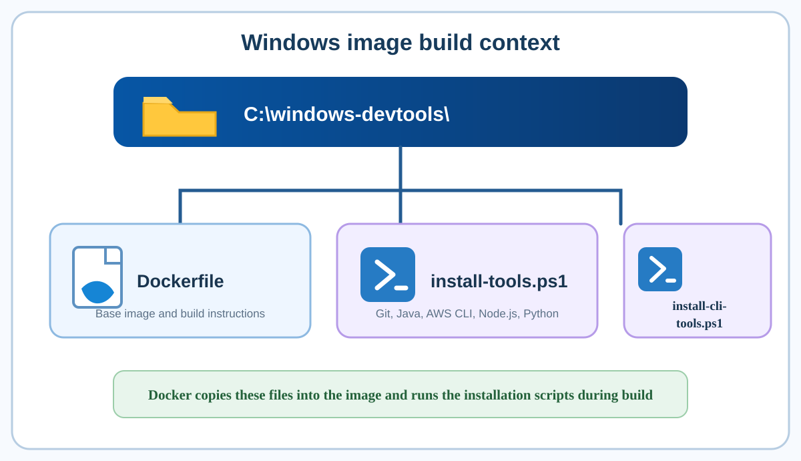

# Windows Developer Tools on Amazon EKS

Build a reusable Windows developer workspace image, publish it to Amazon Elastic Container Registry (Amazon ECR), and run it as a Windows container on Amazon Elastic Kubernetes Service (Amazon EKS).

The workspace provides an interactive PowerShell environment with a consistent set of development and DevOps tools. Developers connect with `kubectl exec`; they do not need to log in to the underlying Windows worker node for normal workspace use.

> **Scope:** This is a reference implementation for a Windows developer container on EKS, not a complete multi-tenant developer portal.

## Architecture and end-to-end flow




1. Maintain the Dockerfile and PowerShell installation scripts in this repository.
2. Build the custom Windows image on a compatible Windows container build host.
3. Tag the image and push it to Amazon ECR.
4. Deploy the image to EKS with a Windows node selector.
5. EKS schedules the pod on a compatible Windows worker node and pulls the image.
6. A developer opens an interactive PowerShell session with `kubectl exec -it`.
7. Verify the installed tools inside the container.


### Docker build context

The image build uses one Dockerfile and two PowerShell scripts:



See the [implementation guide](docs/implementation-guide.md) and [Kubernetes deployment template](kubernetes/windows-devtools-deployment.yaml).

## Engineering reference

- [Troubleshooting notes](docs/troubleshooting.md) — scheduling, disk pressure, image pulls, interactive access, and port-forwarding.
- [Design decisions](docs/design-decisions.md) — rationale and trade-offs behind the Windows base image, build host, ECR, scripts, node selection, and interactive access.
- [Version matrix](docs/version-matrix.md) — v6 tool versions, pinning notes, and validation commands.

## Tools included in the v6 build

| Tool | Version |
|---|---:|
| Git | 2.56.0 |
| Node.js | 24.22.3 |
| npm | 11.19.1 |
| Python | 3.14.9 |
| pip | 26.2.2 |
| OpenJDK | 17.0.21 |
| AWS CLI | 2.41.0 |
| kubectl | 1.37.2 |
| Terraform | 1.17.2 |

Versions above reflect the v6 project validation notes. Re-run the verification commands after changing installers or rebuilding the image.

## Repository layout

```text
.
├── Dockerfile
├── install-tools.ps1
├── install-cli-tools.ps1
├── kubernetes/
│   ├── namespace.yaml
│   └── windows-devtools-deployment.yaml
├── docs/
│   ├── architecture.svg
│   ├── build-context.svg
│   └── implementation-guide.md
└── README.md
```

## Quick start

### Build the image

Run on a Windows host configured for Windows container builds and compatible with the Windows Server Core LTSC 2025 base image:

```powershell
docker build -t windows-devtools:v6 .
```

### Tag and push to Amazon ECR

Replace the placeholders with your AWS account ID, Region, and ECR repository:

```powershell
$Region = "<AWS_REGION>"
$AccountId = "<AWS_ACCOUNT_ID>"
$Repository = "windows/demo"
$Tag = "devtools-v6"
$Image = "$AccountId.dkr.ecr.$Region.amazonaws.com/$Repository`:$Tag"

aws ecr get-login-password --region $Region |
  docker login --username AWS --password-stdin "$AccountId.dkr.ecr.$Region.amazonaws.com"

docker tag windows-devtools:v6 $Image
docker push $Image
```

The ECR repository must exist before pushing unless repository creation is automated in your environment.

### Deploy to EKS

Update the image field in `kubernetes/windows-devtools-deployment.yaml` with the full ECR image URI, then run:

```powershell
kubectl apply -f kubernetes/namespace.yaml
kubectl apply -f kubernetes/windows-devtools-deployment.yaml
kubectl get pods -n windows -o wide
```

### Open an interactive session

```powershell
kubectl exec -it -n windows deployment/windows-devtools-v6 -- powershell.exe
```

### Verify the tools inside the container

```powershell
git --version
node --version
npm --version
python --version
pip --version
java -version
aws --version
kubectl version --client
terraform version
```

## Operational notes

- **Windows compatibility:** The Windows container image and Windows worker node OS/build must be compatible. Confirm compatibility for the EKS AMI and container runtime in your cluster.
- **Build host:** Build Windows images on a compatible Windows container build environment. The EKS worker uses containerd; Docker is not required on the worker node.
- **AWS permissions:** Installing AWS CLI does not grant AWS access. Configure an appropriate workload identity, such as EKS Pod Identity or IRSA where supported, with least-privilege IAM permissions.
- **Kubernetes permissions:** kubectl also requires a valid cluster authentication method and appropriate Kubernetes RBAC permissions.
- **Persistence:** Files written only to the container writable layer can be lost when a pod is replaced. Use persistent storage for workspaces that must survive pod replacement.
- **Image security:** Pin tool versions, verify downloaded artifacts with trusted checksums, scan the image, and rebuild regularly.
- **Secrets:** Never store AWS credentials, kubeconfig files, tokens, private keys, or other secrets in the image or repository.

## Project status

The v6 image was built and pushed to ECR, deployed to an EKS Windows worker, accessed interactively using `kubectl exec`, and the installed tools were checked inside the container.

## Roadmap

- [ ] Add real implementation screenshots under `docs/screenshots/` (image build, ECR push, running pod, interactive shell, and package verification).
- [ ] Add an automated image verification script.
- [ ] Add checksum validation for downloaded installers and CLI binaries.
- [ ] Add image vulnerability scanning to the image publishing workflow.
- [ ] Add a CI workflow using a compatible Windows image builder.
- [ ] Add persistent workspace storage and per-developer isolation guidance.

## Disclaimer

This is a learning and reference project. Review Windows container compatibility, IAM, Kubernetes RBAC, storage, resource sizing, and image security before adapting it for production.